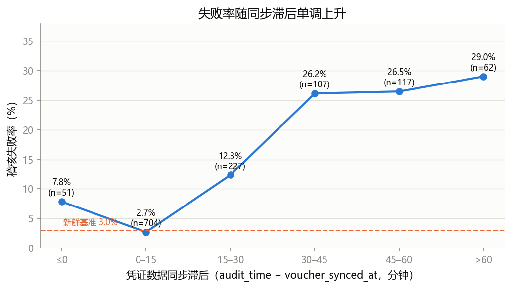
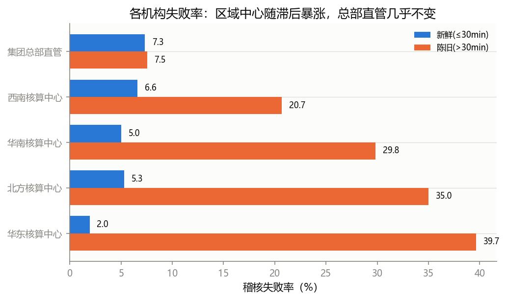
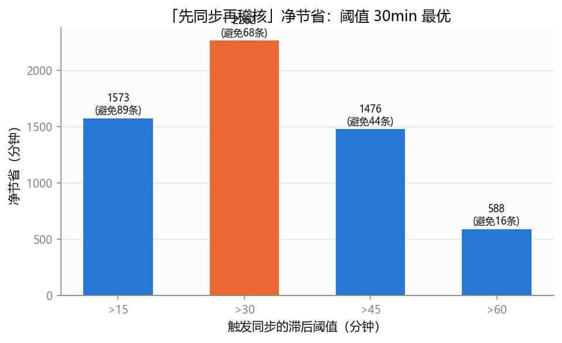

# 进项发票与财务凭证自动稽核 —— 失败瓶颈分析

我理解的问题是，找到稽核失败的原因，并尽可能找出解决方法。

## 一、我的判断

### 看到了什么

数据是 `audit_records.csv`（1268 条稽核流水）。先把 `audit_time` 和 `voucher_synced_at` 转为同一时区（+08:00），再统计 `audit_result` 和其他属性之间是否有联系。

`audit_result` 分布：

| audit_result | 含义 | 条数 | 占比 |
|---|---|---|---|
| `1` | 核对一致 | 1080 | 85.2% |
| `0` | 异常需人工介入 | 128 | 10.1% |
| 空 | 未回传 | 60 | 4.7% |

核心发现：**失败率随「凭证数据同步滞后」单调上升**。滞后 = `audit_time` − `voucher_synced_at`（分钟，正数表示凭证数据更旧）。

| 同步滞后 | 记录数 | 失败率 |
|---|---|---|
| ≤0 min | 51 | 7.8% |
| 0–15 min | 704 | 2.7% |
| 15–30 min | 227 | 12.3% |
| 30–60 min | 224 | 26.3% |
| >60 min | 62 | 29.0% |

失败记录的平均滞后是 **36.6 min**，成功记录只有 **17.3 min**（约 2 倍）。



### 根问题

**核心瓶颈不是「发票与凭证真的对不上」，而是「凭证数据没有及时同步」——稽核基于过期数据执行，被误判为失败。**

关键证据：控制滞后后，四个区域中心的失败率都随滞后暴涨（新鲜 2–7% → 滞后 21–40%），唯独「集团总部直管」的失败率几乎不随滞后变化（7.3% vs 7.5%）。这说明数据真正新鲜时，滞后就不再导致失败，总部直管的数据同步机制可作为其他机构的标杆。



次要问题（属于真实不匹配，同步救不了）：
- 额度耗尽：`credit_balance ≤ 5` 时，即使数据新鲜，失败率也有 8.3%（其余分桶约 2–6%）。
- 大额发票：`invoice_tax_amount > 80` 时，新鲜数据失败率 15.4%（其余分桶约 3–6%）。

## 二、做了什么

1. **时区统一**：把 `voucher_synced_at` 从 UTC 转为与 `audit_time` 相同的 +08:00 → `audit_records_processed.csv`（脚本 `scripts/convert_timezone.py`）。
2. **关系分析**：统计 `audit_result` 与 `branch_name`、`business_category`、同步滞后、`credit_balance`、`invoice_tax_amount` 的关系（脚本 `scripts/analyze_bottleneck.py`、`analyze_bottleneck2.py`、`analyze_credit_roi.py`）。
3. **ROI 测算**：按口径「失败 75 min / 次、触发同步 10 min / 次」，比较「先同步再稽核」在不同滞后阈值下的净节省。

## 三、怎么证明有用

口径：每次稽核失败人工介入约损失 **75 分钟**；每拦截并触发凭证同步一次约 **10 分钟**。

当前成本：128 次失败 × 75 分钟 = **9600 分钟**。

方案：对「同步滞后 > 30 min」的稽核请求，先拦截触发凭证同步，再执行稽核。

| 触发同步阈值 | 触发同步次数 | 当前失败数 | 可避免失败数 | 省人工(min) | 同步成本(min) | 净节省(min) |
|---|---|---|---|---|---|---|
| 滞后 >15 min | 513 | 105 | 89 | 6703 | 5130 | 1573 |
| **滞后 >30 min** | **286** | **77** | **68** | **5122** | **2860** | **2262** |
| 滞后 >45 min | 179 | 49 | 44 | 3266 | 1790 | 1476 |
| 滞后 >60 min | 62 | 18 | 16 | 1208 | 620 | 588 |

- 阈值取 **30 min** 净节省最多：**≈ 2262 分钟 ≈ 37.7 小时 ≈ 4.7 个工作日**。
- 可避免 **~68 / 128（53%）** 条失败，总耗时从 9600 降到约 7340 分钟（降 24%）。



## 四、可复现脚本

依赖：Python 3 + pandas。

```bash
pip install pandas

python scripts/convert_timezone.py     # 生成 audit_records_processed.csv（统一时区）
python scripts/analyze_bottleneck.py   # 失败分布 + 滞后按结果分组对比
python scripts/analyze_bottleneck2.py  # 失败率(带分母) + 滞后单调性 + 机构/大类控制
python scripts/analyze_credit_roi.py   # credit/金额验证 + ROI 测算
```

## 五、后续迭代方向（收益 / 成本 / 优先级）

优先级按「单位成本的预期收益」排序（收益估算基于当前数据，未造数）。

| 优先级 | 迭代方向 | 预期收益 | 成本 | 关键不确定性 |
|---|---|---|---|---|
| ~~P1~~ **已执行，不可行** | 真实不匹配分流规则（credit_balance / invoice_tax_amount 阈值） | **负收益**：精确率仅 8.5%（接近随机基线 5.2%），误报 204 条 ≫ 命中 19 条，净节省约 **-5265 min**（详见 5.2） | 低（已做） | 低 |
| **P2** | **未解释「新鲜失败」归因**（32 条） | 滞后≤30、额度充足、金额正常却仍失败，是同步救不了的硬骨头；上限 **32×75=2400 min** | 中：需更细特征或补数据 | 中 |
| **P3** | **未回传(空)根因排查**（60 条） | 上限 **60×75=4500 min**；但题目口径未给未回传成本，且当前机构/大类/时段均无强信号，疑似系统回传问题 | 中：需补系统侧数据（回传日志/超时） | 高 |
| ~~P4~~ **已执行，收益极小** | 精准拦截模型（纳入 credit/tax/类别/机构的模型） | 模型 AUC 0.762 仅比 lag 单特征 0.757 高 **0.005**，多特征几乎不增加预测力；固定 lag>30 规则已近最优，无需模型（详见 5.3） | 中（已做） | 低 |
| ~~P5~~ **已执行** | 负滞后排查 + 可视化 + 稳健性 | 负滞后其实全为 0（非数据竞争）；主结论稳健：同步成本≤18min、人工成本≥40min 时方案均盈利（详见 5.4 + figures/） | 低（已做） | 低 |

**推荐顺序（P1、P4、P5 已执行）：P2 → P3。**
P1 不可行（credit/tax 弱信号、净亏损）；P4 收益极小（模型≈lag 单特征）；P5 已收尾（可视化 + 稳健性，主结论稳健）。剩余仅 P2/P3（需补数据）。

### 5.1 不补充数据时，各方向能做什么

仅用现有 8 个字段（不引入新数据源），逐方向盘点可落地动作；标注「✅ 可完全落地」与「⚠️ 仅能诊断（受数据限制）」。

**P1 真实不匹配分流规则 —— ❌ 已执行，结论不可行**
1. 已做：全阈值扫描 `credit_balance`、`invoice_tax_amount` 及联合规则（`scripts/optimize_p1_threshold.py`）。
2. 结果：所有规则精确率仅 8–17%（基准失败率 5.2%），最优联合规则（credit≤2 或 tax≥89）F1=0.197、精确率 14.9%、召回率 29.4%，按预检 30min 计净节省 -1905min。
3. 结论：credit/tax 对「真实失败」区分能力太弱，任何分流规则都因误报过多而净亏损；反向印证「同步滞后是唯一强信号」。

**P2 未解释「新鲜失败」归因 —— ⚠️ 仅能诊断**
1. 对 32 条未解释新鲜失败 vs 成功记录，逐字段对比（branch / category / credit / tax / lag 精确值 / 时段）。
2. 判定现有 8 字段还能解释多少、哪些字段完全无关，划出「可解释边界」。
3. 结论输出：这 32 条需要哪些**额外字段**（如发票状态、凭证状态、复核记录）才能归因——即给出补数据清单，而非在现有数据里硬找。

**P3 未回传(空)根因 —— ⚠️ 仅能更细诊断**
1. 按日期/小时/分钟看 60 条是否成批次（疑似系统窗口），按 branch×category×lag 看局部集中。
2. 判断现有数据能否定位；大概率结论是「需系统回传日志/超时记录」。
3. 结论输出：给系统侧要补的数据清单。

**P4 精准拦截模型 —— ❌ 已执行，结论：无需模型**
1. 已做：numpy 手写逻辑回归（无 sklearn），时间切分 train/test（966/242），lag 单特征 vs 全特征。
2. 结果：全模型 AUC 0.762 仅比 lag 单特征 0.757 高 0.005；召回率@K 几乎一致；测试集头对头净节省 885 vs 810min（+75，且主要由 lag 贡献）。
3. 结论：credit/tax/类别/机构不增加预测力，固定 lag>30 规则已近最优，复杂模型是过度工程。

**P5 负滞后 + 可视化 + 稳健性 —— ✅ 已执行（详见 5.4）**
1. 负滞后排查：51 条 lag 全为精确 0（非负），无「数据竞争」证据；lag=0 失败率 7.8% 是次要小现象。
2. 可视化：生成 3 张图（失败率-滞后、净节省-阈值、机构新鲜/陈旧对比），见 `figures/`。
3. 稳健性：主结论在同步成本≤18min、人工成本≥40min 内均盈利（详见 5.4）。

**小结**：P1、P4、P5 均已执行——P1 不可行（credit/tax 弱信号、净亏损），P4 收益极小（模型≈lag 单特征），P5 收尾（可视化 + 稳健性）。三者共同印证：现有字段中只有「同步滞后」是强信号，简单规则已近最优且稳健；其余真实失败无法用当前数据预测，需补数据（P2）。

### 5.3 P4 执行结果（精准拦截模型）

numpy 手写逻辑回归（无 sklearn），时间切分 train/test（966/242，剔除未回传），比较「lag 单特征」与「全特征（lag+credit+tax+类别+机构）」对失败（`audit_result==0`）的预测力。

| 指标 | lag 单特征 | 全模型 | 增量 |
|---|---|---|---|
| 测试集 AUC | 0.757 | 0.762 | **+0.005** |
| 召回率@同步100条 | 23/31 | 23/31 | 0 |
| 召回率@同步200条 | 29/31 | 29/31 | 0 |
| 头对头净节省（同54次同步） | 810 min | 885 min | +75 min |

- 全模型 AUC 仅比 lag 单特征高 0.005，说明 credit/tax/类别/机构对失败预测**几乎无增量**，与 P1 的结论（credit/tax 弱信号）一致。
- 测试集上模型最优工作点净节省 975min vs 固定 lag>30 规则 810min（+165min），但该增益来自「用 lag 更精细排序」，并非多特征贡献，且测试集仅 31 条失败、波动大。
- **结论**：固定 `lag>30` 规则已近最优，无需机器学习模型；「同步滞后」是唯一强信号。

### 5.2 P1 执行结果（阈值优化）

在新鲜数据（lag≤30，982 条、真失败 51 条、基准失败率 5.2%）上全阈值扫描（脚本 `scripts/optimize_p1_threshold.py`）。成本模型：失败人工 75min、预检 30min（假设），净节省 = 命中×45 − 误报×30。

| 规则 | 命中 | 命中真失败 | 精确率 | 召回率 | 净节省(估) |
|---|---|---|---|---|---|
| 原规则 credit≤5 或 tax>80 | 223 | 19 | 8.5% | 37.3% | -5265 min |
| 最优联合 credit≤2 或 tax≥89 | 101 | 15 | 14.9% | 29.4% | -1905 min |

- 精确率仅 8.5%–14.9%，离随机基线 5.2% 很近，误报远多于命中，任何阈值都净亏损。
- 结论不依赖 30min 假设：要扭亏，预检成本须低于 `75 × 精确率`（原规则 <6.4min、最优 <11.2min），对人工分流不现实。
- **含义**：credit/tax 是弱信号，真实不匹配无法用现有字段预测——这反向支持「同步滞后是唯一强信号」的主结论，并把剩余真失败的归因指向 P2（补数据）。

### 5.4 P5 执行结果（负滞后排查 + 稳健性）

**负滞后排查**：51 条 lag≤0 的记录，其滞后**全部精确等于 0**（mean=std=0），不存在真正「负滞后」。因此「稽核读到未同步数据（数据竞争）」的假设不成立；这些只是「同步与稽核同一时刻」的记录，失败率 7.8%（略高于新鲜 2.7%、低于陈旧 26%），是小规模次要现象，不值得单独处理。

**主结论稳健性（敏感性分析）**：

| 敏感性维度 | 盈亏平衡点 | 口径值 | 结论 |
|---|---|---|---|
| 同步成本 | ≤ **17.9 min**（超出则转亏） | 10 min | 约 80% 安全边际 ✅ |
| 人工成本 | ≥ **~40 min**（低于则转亏） | 75 min | 约 47% 安全边际 ✅ |

- 同步成本从 5→30min 变化时，最优阈值从 15min 上移到 60min，净节省从 +4138min 降到 -652min；只要同步成本 ≤18min，方案始终盈利。
- 人工成本从 40→120min 变化时，净节省从 +24min 升到 +5595min；只要人工成本 ≥40min，方案始终盈利。
- **结论**：在题目口径（同步 10min、人工 75min）下，主结论「滞后>30min 先同步、净省 ~2262min」有充分安全边际，稳健成立。

## 六、改进记录

（48 小时内若有迭代改进，在此记录改了什么。）
